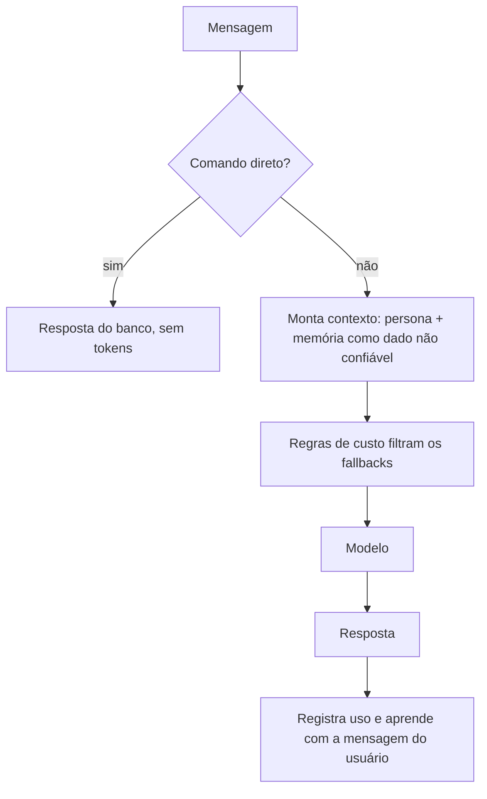
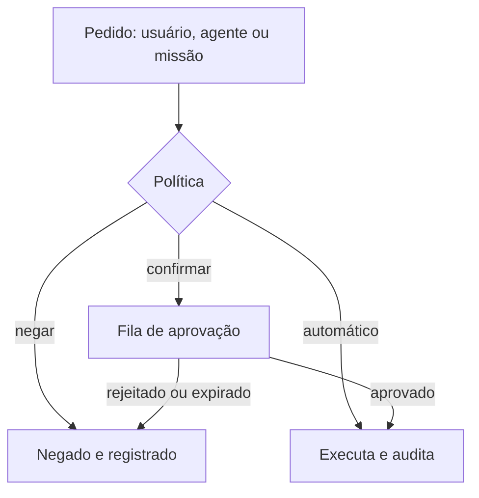
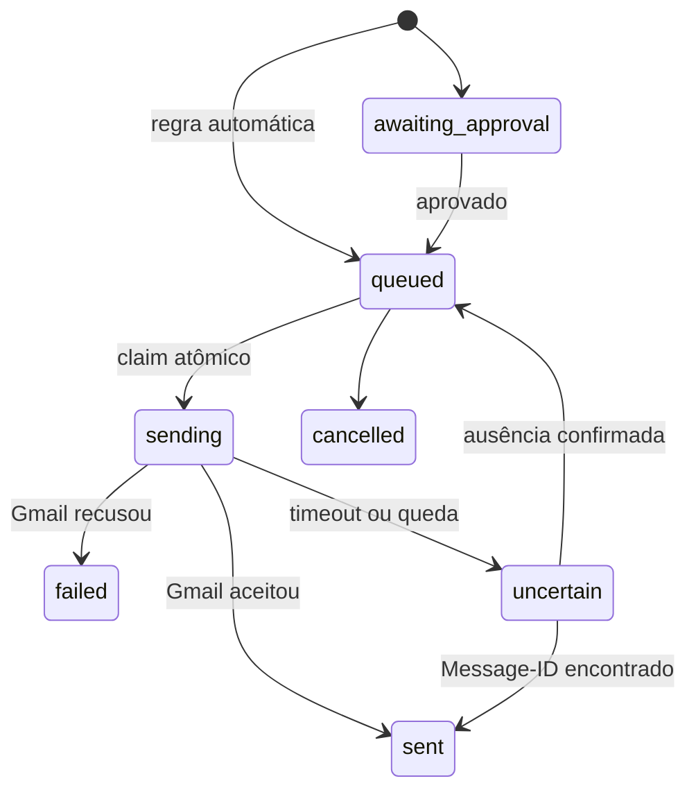

# Diagramas

## Uma mensagem no chat

## Uma ação com efeito externo

O risco é definido no código de cada ação. Ações destrutivas, financeiras e físicas críticas sempre passam pela fila, seja qual for a regra configurada.

## Envio de e-mail sem duplicidade

